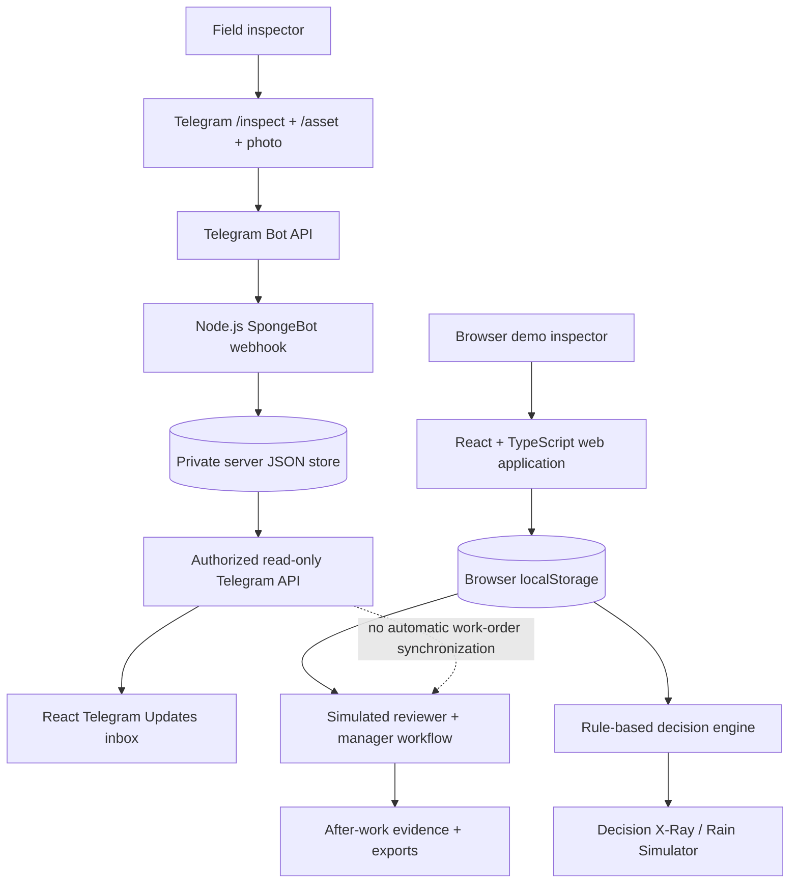

# SpongeCheck 2.0

### Inspect smarter. Maintain responsibly.

**An evidence-led, ecology-conscious inspection and maintenance decision-support prototype for township stormwater assets and urban wetlands.**

**Sime Darby Property University Hackathon 2026** · **Township of Tomorrow** · **Planet Track — Climate Resilience & Biodiversity**  
**Institution:** Albukhary International University (AIU), Malaysia  
**Project status:** Functional hackathon prototype; not a production field-management system  
**Source code:** [github.com/chitko84/spongecheck_system](https://github.com/chitko84/spongecheck_system)

> **Live demo:** Add the exact public Vercel deployment URL here before final submission. The team's production frontend build has passed and the Vercel deployment was reported working on 23 October 2026; the URL was not supplied for this document. The Telegram backend requires separate hosting and configuration.

---

## Executive summary

Townships increasingly depend on stormwater systems that do more than carry runoff. Wetlands, planted swales, detention ponds, inlets and outlets must remain functional while continuing to support water quality, habitat and public amenity. Maintaining these assets involves a deceptively difficult operational question: **how can a field observation become a timely, explainable and environmentally responsible maintenance decision?**

**SpongeCheck 2.0** explores that question through a mobile-first web application and a companion Telegram bot, **SpongeBot**. An inspector can document visible conditions; a manager can compare inspection priorities under explicitly simulated rainfall scenarios; a nature reviewer can examine sensitive proposed work; and the demo workflow can record assignment, completion photographs, verification and exportable evidence.

The distinguishing design choice is **traceability rather than opaque automation**. SpongeCheck's *Decision X-Ray* exposes every factor contributing to an illustrative priority score. Its maintenance state machine prevents a review-required proposal from advancing to assignment before simulated specialist approval. Its before-and-after comparison links a proposed action to documented completion and verification.

The working prototype demonstrates these interactions, but it **does not predict flooding, interpret photographs using AI, authorize real maintenance, measure ecological improvement, or integrate Telegram submissions automatically into the browser-maintenance workflow**. Those are distinct future engineering and governance tasks.

**Core proposition:** Make it easier to see an issue, understand its priority, protect ecological interests and establish what happened next.

---

## Contents

1. [The problem and Malaysian context](#1-the-problem-and-malaysian-context)
2. [Project objectives](#2-project-objectives)
3. [Target users and value proposition](#3-target-users-and-value-proposition)
4. [Solution and implemented capabilities](#4-solution-and-implemented-capabilities)
5. [What makes SpongeCheck different](#5-what-makes-spongecheck-different)
6. [System architecture and data boundaries](#6-system-architecture-and-data-boundaries)
7. [Decision-support methodology](#7-decision-support-methodology)
8. [End-to-end demonstration](#8-end-to-end-demonstration)
9. [Technology and repository structure](#9-technology-and-repository-structure)
10. [Run locally](#10-run-locally)
11. [Telegram integration](#11-telegram-integration)
12. [Testing and verification evidence](#12-testing-and-verification-evidence)
13. [Security, privacy and limitations](#13-security-privacy-and-limitations)
14. [Impact model and proposed pilot](#14-impact-model-and-proposed-pilot)
15. [Deployment guidance](#15-deployment-guidance)
16. [Team and acknowledgements](#16-team-and-acknowledgements)
17. [References and licensing](#17-references-and-licensing)

---

## 1. The problem and Malaysian context

Malaysia's **Department of Statistics (DOSM)** reported **RM636.9 million** in flood-related losses for 2025, including **RM380.2 million** attributed to **public assets and infrastructure**. The latter represents approximately **59.7% of reported total losses** (`380.2 / 636.9 × 100`). This is a measure of national flood-damage exposure; **it does not establish that blocked drains caused those losses, or that SpongeCheck would have prevented them**. [1]

For township operators, stormwater inspection creates a parallel operational challenge:

- A blockage or sediment accumulation may first be visible to a field inspector, but its supporting photograph and location must reach the appropriate reviewer.
- Not every observed issue merits the same response, and missing or uncertain observations should be shown rather than hidden.
- A maintenance action that appears beneficial for drainage can disturb vegetation, sediment or sensitive habitat if undertaken without proper ecological judgment.
- Teams need an accessible record of what was proposed, who reviewed it, what work was performed and whether the evidence was verified.

The need is particularly relevant to **nature-based stormwater systems**. Sime Darby Property describes its Bandar Bukit Raja wetland and green-blue infrastructure as combining water management, biodiversity and community benefits. SpongeCheck proposes a complementary **operational decision and documentation layer**; it does not suggest that existing SDP infrastructure is deficient or that it has been validated at an SDP site. [2][3]

The Department of Irrigation and Drainage's *Urban Stormwater Management Manual for Malaysia (MSMA, second edition)* provides relevant professional context, but SpongeCheck's demonstration rules **are not derived engineering design thresholds and must not be used instead of qualified engineering assessment**. [4]

### Problem statement

> Township operators need a low-friction way to convert visible stormwater-asset concerns into **documented, explainable, ecology-aware inspection and maintenance decisions**, without losing evidence between reporting, review and closure.

## 2. Project objectives

SpongeCheck pursues six practical objectives:

1. **Reduce reporting friction:** allow an approved demonstration inspector to send a location, photo and note using familiar Telegram commands, or create a structured report in the web app.
2. **Make prioritization understandable:** reveal the observation and scenario factors behind every rule-based result.
3. **Surface uncertainty:** distinguish confirmed observations from missing, ambiguous or illustrative example data.
4. **Build an ecological checkpoint:** require an explicit specialist-review step for selected intervention types before simulated work assignment.
5. **Close the evidence loop:** document proposed work, assignment, after-work photographs, verification and event history.
6. **Support a realistic pilot path:** define the people, permissions, data integration and measurement needed before any real-world deployment.

These objectives are **prototype design goals**, not claims of already demonstrated environmental or financial outcomes.

## 3. Target users and value proposition

| Stakeholder | Current decision need | SpongeCheck prototype contribution |
| --- | --- | --- |
| **Field inspector** | Capture an issue quickly and clearly | Phone-friendly inspection form; optional allowlisted Telegram photo intake; progress and completion evidence |
| **Operations manager** | Decide what deserves attention and coordinate follow-up | Places overview, rule-based priority comparison, work proposals, assignments and verification |
| **Nature/ecology reviewer** | Prevent unnecessary or unreviewed habitat disturbance | Review-required intervention gate, approval/rejection rationale and activity history |
| **Township management / reporting teams** | Demonstrate what was observed and done | Traceable case views, before-and-after evidence, exportable PDF/HTML/JSON/CSV |
| **Residents and communities** | Benefit from well-managed green-blue infrastructure | **Potential indirect benefit only**; no public resident reporting or verified resident-outcome feature is claimed |

The app offers selectable **demo personas**, not authenticated employee accounts. Real permissions would require a production identity and authorization system.

## 4. Solution and implemented capabilities

### 4.1 Place-based inspection

The responsive web interface provides a dashboard, an illustrative Places view, and a **three-step inspection** experience with photograph selection/upload, editable observations and review before submission. Browser-created demo reports persist in the **same browser's localStorage**.

The six **fictional** sample locations are:

| ID | Demonstration asset |
| --- | --- |
| `A-01` | Wetland Outlet |
| `B-02` | Reed Habitat |
| `C-03` | Planted Swale |
| `D-04` | Pond Inlet |
| `E-05` | Wetland Cell |
| `F-06` | Detention Pond |

These are illustrative asset records—not surveyed, geolocated or verified SDP infrastructure.

### 4.2 SpongeBot: Telegram photo intake

An allowlisted inspector can interact with **@SpongeCheckAI2026Bot** using `/inspect`, `/asset A-01`, a photograph with an optional caption, and `/status <case-id>`. When a webhook and server are configured, the backend creates a case such as `SC-TG-73599370` and can send a manager notification to a configured chat.

A **Telegram Updates** page in the web application retrieves these records from the protected backend API. **This is deliberately a separate, read-only inbox:** Telegram cases are **not** automatically turned into editable browser work orders or granted ecological approval. Submitted photo observations remain **awaiting human confirmation**.

### 4.3 Rain Simulator

The Rain Simulator compares three **synthetic scenarios**:

| Scenario | Illustrative amount |
| --- | ---: |
| Dry | 0 mm |
| Moderate | 20 mm |
| Heavy | 65 mm |

These amounts are demonstration inputs without a specified forecast duration or site calibration. They are **not live meteorological observations, warning thresholds or flood forecasts**.

### 4.4 Decision X-Ray

The **Decision X-Ray** explains the rule-based prioritization output with named factors, score contributions, scenario information, provenance and uncertainty flags. The queue and explanation screen use the **same decision function**, reducing the risk of inconsistent rationales.

### 4.5 Ecology-aware maintenance workflow

For **browser-created cases**, SpongeCheck demonstrates:

`Report → Propose maintenance → Nature review (when required) → Manager assignment → Start work → Completion photo + note → Manager verification → Activity record / export`

The state machine checks the selected role, required review decision, assignment status, completion evidence and minimum note lengths. Review-required proposals cannot be assigned before the matching simulated specialist approval.

### 4.6 Evidence and exports

The browser workflow includes an interactive **before-and-after** comparison and an activity history. Report and insights screens support evidence or summary downloads in **PDF, HTML, JSON and CSV** formats. Exports describe the **recorded demonstration workflow**; they do not certify real construction work, ecological compliance or reduced flood losses.

## 5. What makes SpongeCheck different

SpongeCheck is **not marketed as an AI image-diagnosis engine or hydraulic digital twin**. Its differentiation is an integrated *decision-and-accountability workflow* tailored to green-blue infrastructure:

| Design principle | Implemented expression | Why it matters |
| --- | --- | --- |
| **Low-friction intake** | Telegram photo/report commands and mobile web form | Facilitates demonstration field-to-desk reporting |
| **Explainability first** | Decision X-Ray with explicit rule factors | Makes priority recommendations inspectable and contestable |
| **Uncertainty is visible** | Unknown conditions can produce an insufficient-evidence outcome | Discourages false precision |
| **Nature before intervention** | Specialist review gate for potentially sensitive work | Reinforces ecological oversight rather than immediate clearance |
| **Evidence before closure** | Required after-work photo, completion note and manager verification | Demonstrates accountable case completion |
| **Honest operational boundaries** | Read-only Telegram inbox; simulated roles; disclosed synthetic data | Avoids presenting a hackathon workflow as real authorization or real-time forecasting |

The novelty claim is therefore **the composition and UX of these mechanisms for township wetlands**, not exclusive invention of photo reporting, rules engines or workflow approvals.

## 6. System architecture and data boundaries



**Frontend:** React 18 + TypeScript + Vite 5, responsive CSS/Tailwind tooling.  
**Backend:** Node.js 20+ built-in HTTP server; Telegram Bot API via HTTPS webhook.  
**Web demo storage:** browser `localStorage`.  
**Telegram storage:** private JSON file configured with `SPONGECHECK_DATA_FILE`.  
**Communication:** protected HTTP endpoints; origin-restricted cross-origin requests when frontend and backend are on different domains.

### Data ownership and lifecycle

- **Web-created practice reports** stay in the browser where they were created. They do not automatically sync between devices or team members.
- **Telegram-origin reports** stay on the configured backend filesystem, include the authorized user's submitted photo, and can be read through the protected inbox.
- **The two case collections are separate.** Closing a browser practice case does not change a Telegram-origin case.
- A backend on an **ephemeral free hosting instance** may lose photos and reports after a restart or sleep. Persistent records require a durable store and an explicit retention/deletion policy.

## 7. Decision-support methodology

The implemented priority engine is a **deterministic, illustrative ruleset** (`demo-v1.0`) located in [`src/decisionEngine.ts`](src/decisionEngine.ts). Each eligible input adds a visible score contribution:

| Condition | Example points |
| --- | ---: |
| Visible debris | +3 |
| Visible sediment | +2 |
| Asset marked as high criticality | +2 |
| Last inspection older than 14 days (fictional fixture) | +1 |
| Moderate synthetic rain **and** visible debris/sediment | +1 |
| Heavy synthetic rain **and** visible debris/sediment | +3 |

Priority is determined by the illustrative score: `0–2 = routine`, `3–6 = elevated`, `7+ = urgent`. Where **both debris and sediment are unknown**, the engine returns **insufficient evidence**, not a numerical score. Missing inspection dates and uncertain vegetation or debris conditions are shown as caveats.

Separately, the engine marks proposed **vegetation clearance** and **sediment removal** as requiring specialist review. The maintenance workflow is enforced by [`src/caseWorkflow.ts`](src/caseWorkflow.ts). The distinction is intentional: an urgent *inspection* does not automatically authorize an ecologically sensitive *intervention*.

**Scientific boundary:** This score is not trained, statistically validated, hydraulically calibrated or approved by a qualified engineer or ecologist. A production prioritization model would need site inventories, engineering review, local data, validation and formal operating procedures.

## 8. End-to-end demonstration

The following walkthrough separates the **live bot intake** from the **browser-maintenance simulation**.

### Path A — Telegram to read-only review

1. Open **@SpongeCheckAI2026Bot** from an allowed Telegram user account.
2. Send `/start`, then `/inspect` and `/asset A-01`.
3. Upload a **demonstration photograph** and a short caption; receive an `SC-TG-...` case ID.
4. If a separate manager chat is configured and reachable, inspect its notification.
5. On the web app, select **Operations Manager → Telegram Updates**.
6. Enter the backend HTTPS origin and the private dashboard key, then load cases.
7. View the submitted image, caption, timestamp and **Awaiting inspector review** status.

**Stop here for Telegram:** The case is visible but not yet an approved maintenance job.

### Path B — Browser inspection to verified demonstration record

1. Enter the web demo as **Field Inspector**; open **Places** or **Report an Issue**.
2. Create a browser report with an image and confirmed/editable observations.
3. As **Operations Manager** or **Field Inspector**, propose an action such as **Clear vegetation**.
4. Switch to **Nature Reviewer → Approvals**; provide a reason and approve or reject the *demo* proposal.
5. As **Operations Manager**, assign approved work to a crew.
6. As **Field Inspector**, mark work started; upload an after-work image and explanatory completion note.
7. Compare the two images in **Before & After**.
8. As **Operations Manager**, independently verify the evidence or return the case for rework.
9. Review **Activity History** and download an evidence report.

**Separate demonstration:** Open **Rain Simulator**, select Dry/Moderate/Heavy, and inspect **Decision X-Ray** to see how the example priority changes.

All demo roles, site names, sample inspection findings and example completion photos must be clearly described as illustrative. The demonstration does **not** represent work actually undertaken at an SDP site.

## 9. Technology and repository structure

| Layer | Implementation |
| --- | --- |
| User interface | React 18, TypeScript, Vite, responsive CSS |
| Scenario logic | Deterministic TypeScript decision engine |
| Maintenance logic | TypeScript state machine and event history |
| Reporting | Client-side PDF, HTML, JSON and CSV generation |
| Telegram gateway | Node.js ES modules and Telegram Bot API |
| Backend persistence | Local JSON file, atomic file replacement |
| Frontend hosting | Vercel-compatible Vite static deployment |
| Backend hosting | HTTPS Node server; durable disk required for retained data |

```text
spongecheck_system/
├── src/
│   ├── App.tsx                 # Main responsive UI, pages and interactions
│   ├── decisionEngine.ts      # Transparent rule-based priorities
│   ├── caseWorkflow.ts        # Role-gated demo maintenance state machine
│   ├── reportExport.ts        # PDF/HTML/JSON/CSV evidence exports
│   ├── styles.css             # Responsive design system
│   └── main.tsx               # Frontend entry point
├── server/
│   ├── start.mjs              # Node API startup
│   ├── spongebot.mjs          # Telegram handling and protected API
│   └── configure-webhook.mjs # Telegram webhook registration
├── tests/                    # Deterministic rules, workflow and bot tests
├── release/                  # QA, deployment and demo guidance
├── public/                   # Static frontend assets/configuration
├── .env.example              # Variable names only; NO real secrets
├── TELEGRAM_SETUP.md         # Detailed backend instructions
├── image-credits.md          # Third-party photography credits
├── vercel.json               # Static SPA routing configuration
└── package.json              # NPM scripts and application dependencies
```

## 10. Run locally

### Requirements

- **Node.js 20+** (Node 22 recommended) and npm
- A current desktop or mobile browser
- For the **live Telegram pathway only**: BotFather credentials, an allowed Telegram user ID and an HTTPS webhook endpoint

### Start the web application

```bash
# At the repository root, where package.json is located
npm install
npm run dev
```

Open the Vite address printed in the terminal (normally `http://localhost:5173`). The **browser-only demonstration** works without Telegram credentials.

### Check and build

```bash
npm run typecheck
npm run build
npm run preview
```

A successful build writes the production frontend to `dist/`.

### Optional: configure the local Telegram backend

```bash
# macOS/Linux
cp .env.example .env

# Windows PowerShell alternative:
# Copy-Item .env.example .env
```

Edit `.env` locally and **never commit it**. For local development, use:

```dotenv
PORT=8787
SPONGECHECK_DATA_FILE=./.private-spongebot/data.json
SPONGECHECK_ALLOWED_ORIGIN=http://localhost:5173
SPONGECHECK_PUBLIC_APP_URL=http://localhost:5173
SPONGECHECK_DASHBOARD_KEY=REPLACE_WITH_LONG_RANDOM_PRIVATE_VALUE
TELEGRAM_BOT_TOKEN=REPLACE_LOCALLY
TELEGRAM_BOT_USERNAME=SpongeCheckAI2026Bot
TELEGRAM_WEBHOOK_SECRET=REPLACE_WITH_RANDOM_ALLOWED_CHARACTERS
TELEGRAM_ALLOWED_USER_IDS=YOUR_NUMERIC_TELEGRAM_USER_ID
TELEGRAM_MANAGER_CHAT_ID=
TELEGRAM_WEBHOOK_URL=
```

Start the backend in a **second terminal**:

```bash
node --env-file=.env server/start.mjs
```

Vite is configured to proxy local `/api` requests to the Node backend. For live Telegram webhook delivery, the backend must be reachable over **public HTTPS**. See [TELEGRAM_SETUP.md](TELEGRAM_SETUP.md).

## 11. Telegram integration

### Commands

| Command | Purpose |
| --- | --- |
| `/start` | Show bot introduction and consent reminder |
| `/help` | List commands |
| `/inspect` | Begin a photo inspection |
| `/asset A-01` | Choose one of the six fictional locations |
| Send a photo | Store a case with caption and unconfirmed observations |
| `/status SC-TG-...` | Read the status of a case belonging to the same chat user |
| `/cancel` | Cancel the current intake sequence |

### Backend API

| Method and path | Access | Purpose |
| --- | --- | --- |
| `GET /api/telegram/status` | Public, limited status only | Indicates whether the bot is configured and whether an allowed update has arrived |
| `GET /api/telegram/cases` | Private dashboard bearer key | Returns read-only Telegram case records |
| `POST /webhooks/telegram` | Telegram secret-header verification | Receives Telegram updates |

Telegram media intake is limited to eligible **JPEG photographs under 2 MB**. Incoming webhook update IDs are deduplicated and accepted inspector IDs are allowlisted. The configured manager chat notification is optional and can fail independently of case storage; this demo has no durable retry queue.

### Register the HTTPS webhook

After deploying an HTTPS backend, set `TELEGRAM_WEBHOOK_URL` locally to `https://YOUR-BACKEND-HOST/webhooks/telegram`, ensuring the token and secret agree with the hosted environment. Then run:

```bash
node --env-file=.env server/configure-webhook.mjs
```

Verify `GET https://YOUR-BACKEND-HOST/api/telegram/status`, send a fresh test photo and inspect the case from **Telegram Updates** using the protected dashboard key. An active-looking configuration response **alone is not proof of successful end-to-end delivery**.

## 12. Testing and verification evidence

The repository includes a test suite and QA notes; verification was performed at different stages and should not be collapsed into a claim of production certification.

| Verification area | Evidence / current status |
| --- | --- |
| Deterministic decision rules | `node tests/decision_engine_test.cjs` — **13 assertions passed** in the supplied source |
| Maintenance state transitions and guards | `node tests/case_workflow_test.cjs` — **20+ assertions passed** |
| Telegram webhook/authentication/persistence | `node tests/phase6_spongebot_test.mjs` — **passed** using a mocked Telegram API and temporary store |
| Browser interaction and responsive regression | Existing automated UI suites and test logs in `tests/` and `release/FINAL_QA_REPORT.md` |
| React/Vite production build | Project operator reported **`npm run build` succeeded on 23 October 2026** after TypeScript fixes, and reported the Vercel site working |
| Live Telegram intake | Project demonstration showed an actual bot submission and case acknowledgement; not independently established on permanent backend hosting |
| Real SDP field validation and impact measurement | **Not performed** |
| Production identity, secure multiuser synchronization and durable host monitoring | **Not implemented** |

Run the source-level tests:

```bash
npm run test:rules
npm run test:workflow
npm run test:telegram
npm run typecheck
npm run build
```

Some additional Python-driven browser tests in `tests/` require their own browser-testing dependencies and are documented in the release QA notes. The project’s historical QA file predates the later successful production build and live local Telegram demonstration; interpret each result by its recorded date and environment.

## 13. Security, privacy and limitations

### Protections implemented in the prototype

- Telegram allowlist of numeric user IDs and private-chat restriction.
- Verification of Telegram's webhook secret header.
- Dedicated dashboard access key for reading Telegram cases.
- Exact-origin CORS configuration for the separately hosted frontend.
- Duplicate-update handling and request/photo size limits.
- Atomic private JSON-file writes and basic input sanitization.
- Local browser demo state separated from Telegram backend records.

### Important limits before any real-world use

1. **No real identity / authorization system.** Switching browser demo roles does not authenticate a qualified manager, engineer or ecologist.
2. **No real AI photo interpretation.** Telegram photos are recorded, not automatically diagnosed; prewritten sample observations are identified as samples.
3. **No flood forecast or engineering-grade score.** Scenario rainfall and weights are synthetic and uncalibrated.
4. **No automatic Telegram-to-work-order handoff.** Telegram cases appear in a separate read-only inbox.
5. **No central case database for browser reports.** They are device/browser-local, and clearing storage can delete them.
6. **No assured durability on free ephemeral backend hosting.** A sleeping, redeployed or restarted free instance can lose its JSON records and photos.
7. **No validated environmental outcome.** The app does not prove fewer floods, cleaner water or improved biodiversity.
8. **No production-grade operational controls.** Formal identity, security review, audit integrity, backup, recovery, consent, retention, malware screening, notification retries and incident response are future work.

Do **not** send identifiable people, confidential documents or sensitive site data through the demonstration. Never commit `.env` or expose tokens in screenshots, console logs or GitHub issues. Rotate any secrets that were previously disclosed.

### Photography and evidence disclosure

The interface uses illustrative third-party photography credited in [image-credits.md](image-credits.md). Such photographs are **not actual SDP locations** and must not be presented as real inspection or completed-maintenance evidence. Uploaded example images should be described as **demonstration evidence** unless their provenance has been independently verified.

## 14. Impact model and proposed pilot

SpongeCheck's intended contribution is **better operational coordination and documentation**, not a claim that software alone can prevent flooding.

### Expected value to test

- **Responsiveness:** Time from a new observation to first human triage.
- **Documentation quality:** Share of reported issues with a location, photograph, condition note and responsible reviewer.
- **Decision transparency:** Share of priority decisions with a readable factor breakdown and acknowledged uncertainties.
- **Ecological safeguards:** Share of flagged sensitive interventions with documented specialist review before work assignment.
- **Completion assurance:** Share of completed cases with before/after evidence and independent verification.
- **Operational effort:** Inspector and manager time required per report compared with the existing process.

These are **proposed measurement indicators, not achieved outcomes**.

### Proposed 12-week single-township pilot

| Period | Workstream | Success evidence sought |
| --- | --- | --- |
| **Weeks 1–2** | Stakeholder interviews, permissions, asset selection, data-governance plan | Agreed pilot scope and qualified sign-off owners |
| **Weeks 3–4** | Verified asset inventory, real condition taxonomy, baseline process measurement | Approved assets, baselines and risk definitions |
| **Weeks 5–7** | Shared backend, authentication, access controls, audit/retention design | Working multi-user pilot with role enforcement |
| **Weeks 8–9** | Limited supervised field trial and specialist-review procedures | Consented reports, safe escalation, evidence quality |
| **Weeks 10–11** | KPI comparison, usability evaluation, security and ecology review | Quantified findings with sample sizes and limitations |
| **Week 12** | Decision gate: revise, expand or stop | Joint engineering/ecology/operations assessment |

**Pilot dependencies:** township permission; trained operators; professional engineering and ecology review; site-specific risk rules; user consent and privacy controls; durable infrastructure; budget; an escalation protocol; and baseline data. An SDP pilot is a **proposal**, not a confirmed partnership or implementation commitment.

### Practical scaling path

Move from browser-only demonstrations and private JSON storage to a shared database, controlled object storage for photographs, authenticated organizational roles, audit logging, documented service levels and supported integrations. Only then evaluate approved geospatial mapping, measured rainfall feeds, calibrated hydrological analysis and optional computer-vision assistance. Any model output should remain contestable and subordinate to qualified human judgment.

## 15. Deployment guidance

### Frontend: Vercel

Deploy the Vite application from the repository root:

| Setting | Value |
| --- | --- |
| Framework | Vite |
| Root | Repository root containing `package.json` |
| Build | `npm run build` |
| Publish directory | `dist` |

Use `vercel.json` for the app's nested routes. Check `/app/rain`, `/app/telegram` and another deep link directly in a clean browser session.

### Backend: Render or another Node host

Run the backend as a **separate Node Web Service**, not as a static site:

| Setting | Value |
| --- | --- |
| Runtime | Node 20+ |
| Build | `npm install` |
| Start | `node server/start.mjs` |
| Backend CORS origin | Exact Vercel frontend origin, via `SPONGECHECK_ALLOWED_ORIGIN` |
| Private storage | `SPONGECHECK_DATA_FILE` pointing to an appropriate writeable location |

**Render Free warning:** A free Web Service can sleep and has no persistent disk. It is suitable for an explicitly disposable short demo only; it **cannot meet evidence-retention requirements**. Choose a paid instance with a mounted persistent disk or migrate to external durable storage for a real pilot. Configure the Telegram webhook only after the public HTTPS backend and secret variables have been verified.

**Never use `VITE_` prefixes for bot tokens, webhook secrets or dashboard keys:** Vite client variables can be exposed in the browser bundle.

## 16. Team and acknowledgements

**Albukhary International University (AIU), Malaysia**  
**Sime Darby Property University Hackathon 2026 — Planet Track**

| Team member | Contribution area |
| --- | --- |
| **Chit Ko Ko** | Team leader; technical implementation and integration |
| **Nay Paing Oo** | Research, innovation and concept development |
| **Kaung Thiha** | Business case, feasibility, sustainability and impact |
| **Kyaw Zin Win** | Documentation, proposal visuals and presentation |

SpongeCheck was developed as a student innovation prototype in response to the **Township of Tomorrow** challenge. We acknowledge the public guidance of Sime Darby Property, the Malaysian Department of Statistics, the Department of Irrigation and Drainage, Telegram Bot API documentation and credited image contributors.

**No endorsement, field deployment, formal collaboration or approval by Sime Darby Property is implied.**

## 17. References and licensing

### Research and operational references

1. **Department of Statistics Malaysia (DOSM).** (2026, 15 April). *Special Report on Impact of Floods in Malaysia, 2025.* National flood-loss summary and component figures. https://www.dosm.gov.my/portal-main/release-content/special-report-on-impact-of-floods-in-malaysia2025
2. **Sime Darby Property.** (2024). *Sustainability Report 2024.* Urban stormwater management and Bandar Bukit Raja Wetland Park. https://www.simedarbyproperty.com/sites/default/files/2025-05/SR2024.pdf
3. **Sime Darby Property.** *Bandar Bukit Raja: Wetland Townpark and sustainability initiatives.* https://www.simedarbyproperty.com/bandar-bukit-raja/
4. **Department of Irrigation and Drainage Malaysia.** (2012). *Urban Stormwater Management Manual for Malaysia (MSMA), second edition.* https://wplb.water.gov.my/assets/msma-2nd-edition.pdf
5. **Sime Darby Property.** (2026). *Township of Tomorrow — University Hackathon 2026.* Official challenge and Planet-track context. https://www.simedarbyproperty.com/universityhackathon/
6. **Telegram.** *Bot API documentation.* https://core.telegram.org/bots/api
7. **Pexels.** *Pexels License.* https://www.pexels.com/license/ — see [image-credits.md](image-credits.md) for per-photograph attribution and source links.

### Code and asset rights

The repository does **not currently include an explicit software `LICENSE` file** in the reviewed source package. Public repository visibility is not the same as granting unrestricted reuse. Project maintainers should add an appropriate license only after confirming they have authority to license all code and assets. Third-party photography remains subject to its own license and source conditions.

---

### Final statement

**SpongeCheck 2.0 is a working demonstration of a more accountable maintenance process—not a claim of autonomous environmental decision-making.** Its purpose is to show how simple reporting, transparent prioritization, ecological oversight and verifiable evidence could be joined into a practical operational workflow for greener, more resilient townships.

**Inspect smarter. Maintain responsibly.**
